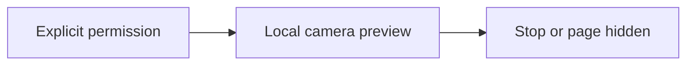

# Agent biométrique — aperçu caméra · Studio Niko Design

**Camera preview only · No measured biometrics**

## État actuel — correction P0

Le [commit source](https://github.com/Nikoju1977/agent-biometrique/commit/7d94d7666ac1ec8c98f4256d689639c49996688e) retire les scores aléatoires, rapports et alertes fictives. Seul l'aperçu caméra facultatif est conservé. L'arrêt explicite, le changement de visibilité et la sortie de page arrêtent les pistes ; une demande devenue obsolète ne doit pas réactiver la caméra.

Aucune mesure de santé ni décision de vigilance. Aucun nouveau test navigateur, audit réseau ou validation clinique exécuté. La qualification des permissions et du cycle de vie reste nécessaire.

## English overview

Camera-preview demonstrator only. Synthetic scores and clinical-looking reports have been removed from the source. Camera lifecycle is guarded against stale requests; runtime behavior remains unverified.

[Notice de droits](LICENSE.md).

## Historique

Les constats antérieurs sont conservés dans l'historique Git du README. Les licences existantes restent inchangées.
