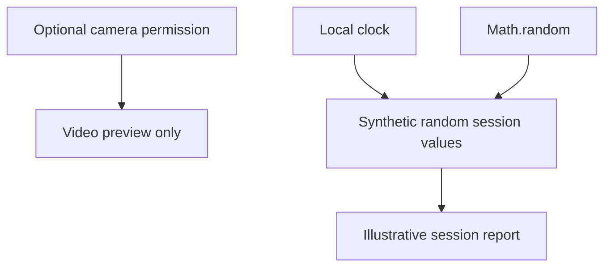

# Agent biométrique — démonstrateur d'interface · Studio Niko Design

**Synthetic session dashboard · Camera preview · No measured biometrics**

> **Avertissement critique : les scores, états et alertes de cette version sont simulés.** Ils ne sont pas déduits des images de la caméra. Ne pas utiliser pour évaluer la fatigue, l'état cognitif, la santé, la conduite, la sécurité au travail, le diagnostic ou un traitement.

## Architecture constatée



| Fonction de [index.html](index.html) | Comportement réel |
| --- | --- |
| `startCamera` | Demande l'accès à la caméra et affiche la vidéo |
| `processFrame` | Produit des états fictifs à partir de l'heure et de valeurs aléatoires, sans lecture des pixels |
| `startAnalysis` | Planifie les échantillons fictifs toutes les 200 ms, arrêt prévu après dix secondes |
| `generateReport` | Calcule les statistiques des scores simulés et sélectionne des textes prédéfinis |

Aucun moteur de mesure biométrique, suivi longitudinal clinique, appel Mistral, graphique Chart.js opérationnel ni coffre AES-256-GCM n'a été établi dans le fichier principal inspecté. Les intitulés de l'interface peuvent donner une impression trompeuse de mesure réelle : cette révision du README ne modifie pas l'interface.

## Priorité critique avant toute démonstration

- Identifier visiblement chaque valeur et rapport comme fictifs, supprimer les formulations cliniques trompeuses et désactiver toute alerte présentée comme réelle.
- Dissocier la simulation de la caméra ; ne demander une permission que lorsqu'elle est nécessaire et vérifier l'arrêt des pistes.
- Vérifier les états de session et l'absence de données médicales ou d'images conservées ou transmises.
- Ne pas présenter de futur moteur de mesure comme opérationnel sans validation appropriée.

Ces actions restent proposées et non implémentées. Aucun test d'exécution, essai caméra, audit de confidentialité ou validation clinique n'a été réalisé ici.

## Consultation locale

```bash
python3 -m http.server 8000
```

Ouvrir http://localhost:8000/ pour examiner l'interface. Ne pas utiliser de données de santé réelles ni de caméra pour une évaluation biométrique.

## English overview

This project is a synthetic dashboard demonstration, not a biometric analysis engine. The camera is a preview; scores are produced from clock-based rules and random values rather than image measurements. Reports summarize simulated data and must not be used for health or safety decisions. Previously advertised AI, longitudinal tracking and encryption were not established in the inspected main file. No runtime or clinical validation was performed.

## Licence

[Notice de droits](LICENSE.md) · Contributions originales concernées : droits réservés. Aucun changement de licence.

[Studio Niko Design](https://github.com/Nikoju1977).
